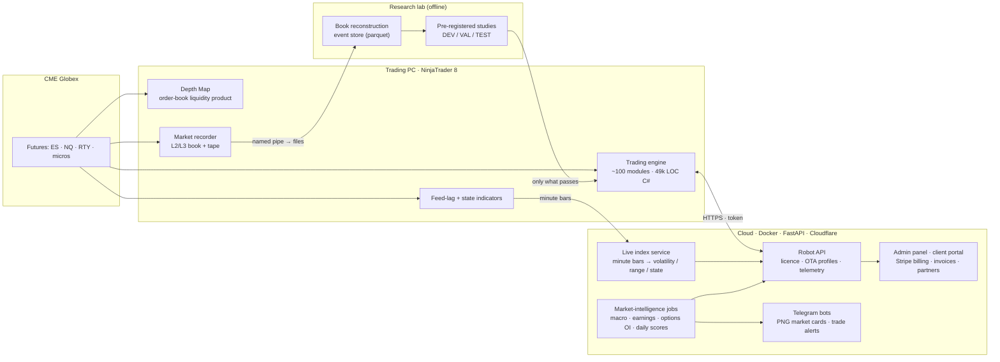

# QuantState — market-microstructure research lab and algorithmic-trading platform

**Author:** Sergei Rokossovskii, founder and owner of **QuantState LLC** (Wyoming, USA) · [quantstate.pro](https://quantstate.pro)

QuantState is a one-person company that I founded and run. I designed, built and maintain the whole stack on my own:
- a trading engine for CME index futures (ES, NQ, RTY and their micro contracts) on NinjaTrader 8;
- an order-book visualisation product;
- the data platform that records the market;
- the research pipeline that decides what goes live;
- the cloud that licenses, configures and monitors every installed copy;
- the business layer: billing, invoices, partners and support bots.

This repository is a **public sample**. The production code, trading logic, parameters, models and data are private: they are the company's commercial value. Here you will find:
- **a full description of the system:** what each part does, at what scale, and the engineering rules behind it ([`docs/`](docs));
- **self-contained, tested modules** written to the same standard as production ([`src/`](src), [`ninjascript/`](ninjascript), [`tests/`](tests)).

---

## Scale (November 2026)

| | |
|---|---|
| **Trading engine** | 117 C# source files, ≈ 49 000 lines — one NinjaTrader 8 strategy assembled from about 100 modules |
| **Platform code in total** | ≈ 80 000 lines of C# (engine, order-book library, indicators, installer / boot loader, market recorder) · ≈ 50 000 lines of Python on the server · ≈ 30 000 lines of Python research code · ≈ 28 000 lines of HTML / JS (admin panel, client portal, 63-page bilingual website) |
| **Cloud API** | 298 HTTP endpoints, 89 database tables, 14 market-intelligence modules, 14 Telegram-bot modules |
| **Remote configuration** | 632 typed, validated parameters per instrument, delivered over the air into running robots; separate day-session / overnight profiles |
| **Automated tests** | 769 server-side tests in 133 files, plus CI on this sample |
| **Recorded data** | ≈ 3.8 bn market events (order book + tape) · 79 GB of live engine journals (72 GB of them order-book "wall" events) · 34 GB raw research event store · 22 GB CME options open-interest history · 1-minute history 2019–2026 for ES, NQ, RTY, YM |
| **Specs and audits** | ≈ 360 written specifications, audit reports and research protocols — every change starts as a document |
| **Release cadence** | 40 releases in the current 71.0.x line alone, each in a Developer and a Commercial build, delivered through signed one-click installers and over-the-air updates |

---

## System map



---

## The parts

### 1. Trading engine (C#, NinjaTrader 8) → [docs/TRADING_ENGINE.md](docs/TRADING_ENGINE.md)
**Event-driven:** it reacts to every trade and every change of the order book, not only to bar closes.

**Pipeline:**
- normalised market data (tick, depth, 1 / 5 / 15-minute series);
- liquidity-level registry and event detectors: walls, refills / icebergs, absorption, sweeps;
- several independent entry logics, each with a **shadow** and a **combat** mode;
- a stack of gates with veto power:
  - session profiles and weekly schedule;
  - market-state filters and news windows;
  - data-lag guard;
  - risk ledger and portfolio risk;
- execution control: order lifecycle, routing to micro contracts, cancel confirmation, late-fill policy, broker reconciliation;
- exit management: stops, targets, break-even, staged trailing, time exits;
- journals of every decision, including the decisions it did **not** take.

### 2. Data platform → [docs/DATA_PLATFORM.md](docs/DATA_PLATFORM.md)
- **Continuous recording:** a dedicated recorder writes the full order book and tape of the trading session through a named pipe.
- **Engine journals:** the engine itself writes structured journals of signals, fills, price paths, shadow trades and rejected candidates.
- **Licensed history and public sources:**
  - licensed vendor history;
  - CME options open interest;
  - macro calendars (Fed, BLS);
  - SEC EDGAR / XBRL fundamentals.
- **Storage:** all of it goes into point-in-time stores, with timestamp audits.

### 3. Research lab → [docs/RESEARCH.md](docs/RESEARCH.md)
- **Pre-registered studies:** rules and acceptance criteria are written down before the data is touched.
- **Chronological DEV / VAL / TEST splits;** the TEST set is opened once.
- **Realistic costs:** commission, slippage on market and stop exits, a limit order counts as filled only on a trade-through.
- **Statistics:** day-block bootstrap and paired "variant − baseline" comparisons.
- **Negative results are recorded and acted on**, exactly like positive ones.

### 4. Cloud platform → [docs/CLOUD_PLATFORM.md](docs/CLOUD_PLATFORM.md)
- licensing with hardware binding and assembly-hash verification;
- over-the-air configuration and software updates;
- telemetry of every decision and trade;
- a live-index service that turns minute bars into volatility, range and market-state indices;
- market-intelligence jobs;
- an admin panel with session-profile editing and period reports (Excel / CSV);
- a client portal, Stripe subscriptions, PDF invoices, a partner / promo-code ledger;
- Telegram bots.

### 5. Release engineering → [docs/RELEASE_ENGINEERING.md](docs/RELEASE_ENGINEERING.md)
- **Two builds from one code base:** Developer (full diagnostics and research taps) and Commercial (slim, obfuscated, without models on disk).
- **Assembly hashes** are registered on the server before a release can go live.
- **One-click installers** with SHA-256 manifests, staged over-the-air updates and integrity checks of the deployed sources.

### 6. Engineering log → [docs/ENGINEERING_LOG.md](docs/ENGINEERING_LOG.md)
Real production incidents and research traps, how they were found and what rule each one added — for example:
- a 12-hour timestamp shift;
- a look-ahead bias that made a filter look 11–14 ticks better than it was;
- limit orders silently expiring on 1-minute charts;
- a database migration that failed without a sound.

---

## Engineering principles
- **Point-in-time data only.** No feature may see the future. Splits are chronological; the test set is opened once.
- **Baselines and acceptance criteria before experiments.** A model that does not beat its baseline does not ship, however good the charts look.
- **Shadow mode first.** A new filter or logic journals what it *would* have done next to every real decision, often for weeks, before it is allowed to act.
- **Safety layers have veto power** over signal layers: risk limits, broker-side stops, naked-position checks, the data-lag guard.
- **Every live component degrades gracefully.** If the server or a data feed is unavailable, the robot falls back to fixed rules instead of stopping or guessing.
- **Everything observable.** Structured logs, per-minute performance counters, telemetry, period reports and alerts.
- **Fact-based audits.** External reviews (human and AI) are checked point by point against data, never accepted or rejected wholesale.

---

## Research record (selected, honest)

| Question | Answer on held-out data |
|---|---|
| Can the **scale** of the next hour (volatility, range) be predicted? | **Yes.** Forecast error (QLIKE) is 0.55 / 0.57 / 0.69 of the implied-volatility baseline for ES / NQ / RTY on 2025–26 data that was never used for fitting. |
| Can the **start of a large move** (timing, no direction) be anticipated? | **Yes, as a probability.** ROC AUC 0.71–0.84 across the Asian, European and US sessions on held-out years. |
| Does that timing index make a fade-type entry profitable as a filter? | **Not proven.** On the historical proxy it did not pass. It runs in shadow mode inside the engine until live evidence decides. |
| Does "the day has covered its expected range" mean "it will reverse"? | **No.** Remaining expansion is predictable; a reversal is not. Exhaustion ≠ reversal. |

Details and the protocol are in [docs/RESEARCH.md](docs/RESEARCH.md).

---

## What is in this repository (runnable code)

| Module | What it shows | Tests |
|---|---|---|
| [`src/qs_range`](src/qs_range) | **Daily range and volatility forecasting:**<br/>• HAR-X and quantile regression with non-crossing quantiles;<br/>• implied-volatility baseline;<br/>• QLIKE, pinball loss, coverage, Diebold–Mariano, Brier skill, ECE;<br/>• exceedance probabilities consistent with the quantiles.<br/>`intraday.py` — next-hour volatility and range from minute bars. | `test_qs_range.py`, `test_qs_intraday.py` |
| [`src/qs_feedlag`](src/qs_feedlag) + [`ninjascript/FeedLagMonitor.cs`](ninjascript/FeedLagMonitor.cs) | **Is the market data late, and why?**<br/>• NinjaTrader 8 indicator: trade-time vs clock baseline, price vs bid/ask, hysteresis;<br/>• episode classifier: shared (network / PC) vs local (one instrument). | `test_qs_feedlag.py` |
| [`src/qs_gate`](src/qs_gate) | **"State opens a window, the trigger acts inside it":**<br/>• threshold-armed permission window with re-arming and fill-based allowance;<br/>• DST-safe exit deadline stamped on the position at entry. | `test_qs_gate.py` |
| [`src/qs_cards`](src/qs_cards) | Market-state card: Jinja2 → PNG via headless Chromium, with a plain-text fallback. | `test_qs_cards.py` |

```bash
pip install -r requirements.txt
pytest -q                     # 18 tests, offline, synthetic data
python examples/run_demo.py   # forecasting scorecard with an honest PASS / FAIL verdict
```

---

## Not included (proprietary)
- trading logics and their parameters;
- order-book registry and detectors;
- index and ML models and their coefficients;
- licensing internals, customer and billing data;
- infrastructure addresses and credentials;
- licensed market data.

## Contact
Sergei Rokossovskii · Founder, QuantState LLC · [quantstate.pro](https://quantstate.pro) · support@quantstate.pro
