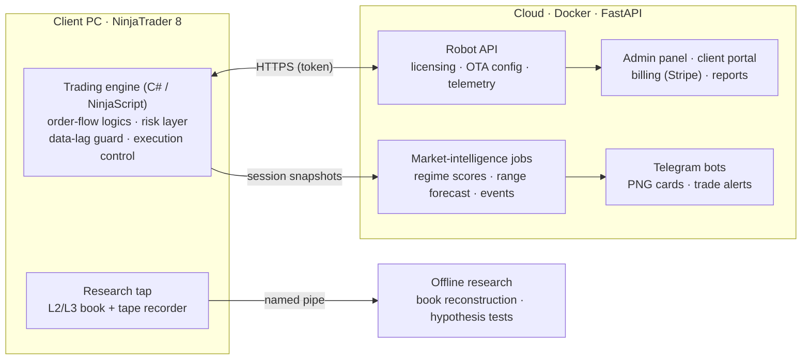

# QuantState — engineering showcase
[](https://github.com/sergeyrokossovsky-rgb/quantstate-showcase/actions/workflows/tests.yml)

**Author:** Sergei Rokossovskii, founder and owner of **QuantState LLC** (Wyoming, USA) · [quantstate.pro](https://quantstate.pro)

QuantState is a market-microstructure research lab and a commercial algorithmic-trading product for CME index futures (ES, NQ, MES, RTY) on NinjaTrader 8. I designed and built the whole stack myself, from the trading engine to billing.

This repository is a **public sample**. The production code base, trading logic, models and data stay private: they are the company's commercial value. What is shown here are self-contained modules written in the same style and to the same engineering standard, together with a description of the system architecture.

---

## The production system (private)



| Area | What it does | Stack |
|---|---|---|
| Trading engine | Several independent entry logics on order flow and limit-order-book state. Layered gates: market regime, model filter, risk veto. Stop / target / trailing management, broker reconciliation, protection against a stale data stream. | C# (NinjaScript), .NET |
| Order-book analytics | Liquidity-level registry: time-weighted presence, wall lifecycle (hold / pull / eaten), iceberg detection. Also shipped as a separate chart product (Depth Map). | C# |
| Cloud | Licence + hardware binding, OTA delivery of session profiles (no reinstall), signed releases, telemetry of every decision and trade, admin panel, client portal, Stripe billing, invoices, partner program. | Python, FastAPI, SQLite, Docker, Cloudflare |
| Market intelligence | Daily and hourly market-state scores; earnings reactions (SEC EDGAR / XBRL); macro calendar (Fed, BLS); daily range forecast in shadow mode; Telegram PNG cards. | Python, statsmodels, Jinja2, Playwright |
| Research | Continuous L2/L3 recording (≈3.8 bn market events), offline book reconstruction, hypothesis tests with DEV / VAL / TEST splits and acceptance criteria fixed in advance. | Python, pandas, parquet |
| Tooling | One-click installers (dev / commercial), assembly hashing, release publishing, integrity checks of generated sources. | Python, MSBuild, PowerShell |

### Engineering principles I apply
- **Point-in-time data only.** No feature may see the future. Splits are chronological, and the test set is opened once.
- **Baselines before models, and acceptance criteria before experiments.** A model that does not beat the baseline does not ship, whatever the charts look like.
- **Shadow mode first.** New logic logs what it *would* do for weeks before it is allowed to act.
- **Safety layers have veto power** over signal layers: risk limits, broker-side stops, naked-position checks, a data-lag guard.
- **Everything observable.** Structured logs, per-minute performance counters, telemetry, Telegram alerts.

---

## What is in this repository

### 1. `src/qs_range` — daily range and volatility forecasting
A compact, tested version of the forecasting protocol I use in production research.
- **Features:** point-in-time HAR(1, 5, 22) lags of the daily range (Corsi 2009); implied volatility of D−1; opening gap; event flag.
- **Models:** HAR-X (OLS in logs with bias correction); linear quantile regression with non-crossing quantiles; implied-volatility baseline.
- **Evaluation:** QLIKE, pinball loss, interval coverage, Diebold–Mariano test (Newey–West), Brier skill, expected calibration error.
- **Exceedance probabilities** come from the same conditional distribution as the quantiles, so they are always consistent: P(> large) ≤ P(> moderate).

```bash
pip install -r requirements.txt
python examples/run_demo.py                                   # offline, synthetic market
python examples/run_demo.py --ohlc SPY.csv --iv VIX_History.csv   # your licensed daily data + public Cboe VIX file
pytest -q
```
On the synthetic market the demo prints a full scorecard and an honest verdict: the volatility model passes its criteria, while the range quantiles do not reach the required 5% gain. Reporting a FAIL is part of the method.

### 2. `src/qs_cards` — market-state card for Telegram
A Jinja2 template is rendered to a PNG by headless Chromium (Playwright); a plain-text fallback carries the same context if rendering or delivery fails. Templates are autoescaped.

### 3. `ninjascript/FeedLagMonitor.cs` — NinjaTrader 8 indicator
Detects a delayed market-data stream. On heavy sessions NinjaTrader can process events minutes after the exchange time while Chart Trader still shows the live quote. Two independent signals:
- event time against a clock baseline (rolling minimum, clamped);
- trade price against the current bid/ask.

Recovery uses hysteresis; Market Replay is ignored. The production engine uses the same principle to block entries, cancel pending orders and pause stop adjustments while the data is stale.

---

## Not included (proprietary)
Trading logics and their parameters, order-book registry and detectors, ML models, licensing / billing / customer data, infrastructure addresses and credentials, licensed market data.

## Contact
Sergei Rokossovskii · Founder, QuantState LLC · [quantstate.pro](https://quantstate.pro) · support@quantstate.pro
