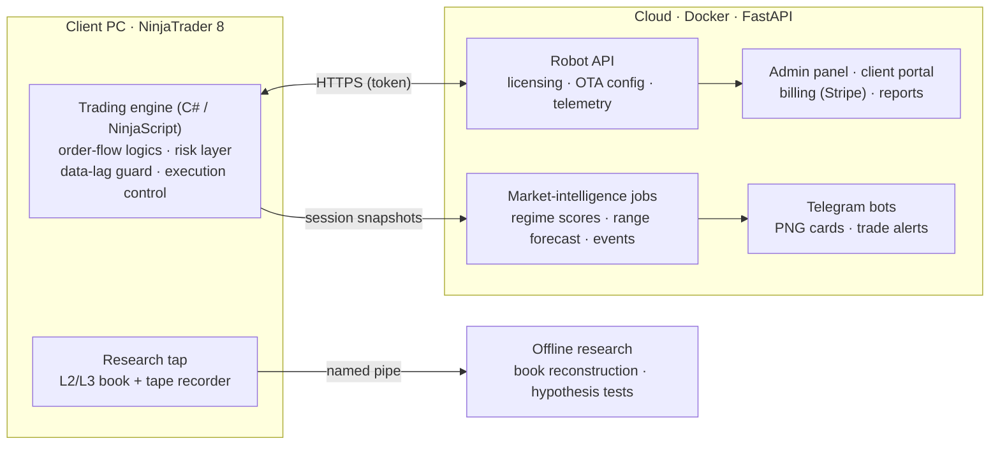

# QuantState — engineering showcase

**Author:** Sergei Rokossovskii, founder and owner of **QuantState LLC** (Wyoming, USA) · [quantstate.pro](https://quantstate.pro)

QuantState is a market-microstructure research lab and a commercial algorithmic-trading product for CME index futures (ES, NQ, MES, RTY) on NinjaTrader 8. I designed and built the whole stack myself, from the trading engine to billing.

This repository is a **public sample**. The production code base, trading logic, models and data stay private: they are the company's commercial value. What is shown here are self-contained modules written in the same style and to the same engineering standard, together with a description of the system architecture.

---

## The production system (private)



| Area | What it does | Stack |
|---|---|---|
| Trading engine | Several independent entry logics on order flow and limit-order-book state. Layered gates: market regime, model filter, risk veto. Stop / target / trailing management, broker reconciliation, protection against a stale data stream. | C# (NinjaScript), .NET |
| Order-book analytics | Liquidity-level registry: time-weighted presence, wall lifecycle (hold / pull / eaten), iceberg detection. Also shipped as a separate chart product (Depth Map). | C# |
| Cloud | Licence + hardware binding, OTA delivery of session profiles (no reinstall), signed releases, telemetry of every decision and trade, admin panel, client portal, Stripe billing, invoices, partner program. | Python, FastAPI, SQLite, Docker, Cloudflare |
| Market intelligence | Daily and hourly market-state scores; earnings reactions (SEC EDGAR / XBRL); macro calendar (Fed, BLS); daily range forecast in shadow mode; Telegram PNG cards. | Python, statsmodels, Jinja2, Playwright |
| Research | Continuous L2/L3 recording (≈3.8 bn market events), offline book reconstruction, hypothesis tests with DEV / VAL / TEST splits and acceptance criteria fixed in advance. | Python, pandas, parquet |
| Tooling | One-click installers (dev / commercial), assembly hashing, release publishing, integrity checks of generated sources. | Python, MSBuild, PowerShell |

### Engineering principles I apply
- **Point-in-time data only.** No feature may see the future. Splits are chronological, and the test set is opened once.
- **Baselines before models, and acceptance criteria before experiments.** A model that does not beat the baseline does not ship, whatever the charts look like.
- **Shadow mode first.** New logic logs what it *would* do for weeks before it is allowed to act.
- **Safety layers have veto power** over signal layers: risk limits, broker-side stops, naked-position checks, a data-lag guard.
- **Everything observable.** Structured logs, per-minute performance counters, telemetry, Telegram alerts.

---

## What is in this repository

### 1. `src/qs_range` — daily range and volatility forecasting
A compact, tested version of the forecasting protocol I use in production research.
- **Features:** point-in-time HAR(1, 5, 22) lags of the daily range (Corsi 2009); implied volatility of D−1; opening gap; event flag.
- **Models:** HAR-X (OLS in logs with bias correction); linear quantile regression with non-crossing quantiles; implied-volatility baseline.
- **Evaluation:** QLIKE, pinball loss, interval coverage, Diebold–Mariano test (Newey–West), Brier skill, expected calibration error.
- **Exceedance probabilities** come from the same conditional distribution as the quantiles, so they are always consistent: P(> large) ≤ P(> moderate).

```bash
pip install -r requirements.txt
python examples/run_demo.py                                   # offline, synthetic market
python examples/run_demo.py --ohlc SPY.csv --iv VIX_History.csv   # your licensed daily data + public Cboe VIX file
pytest -q
```
On the synthetic market the demo prints a full scorecard and an honest verdict: the volatility model passes its criteria, while the range quantiles do not reach the required 5% gain. Reporting a FAIL is part of the method.

### 1b. `src/qs_range/intraday.py` — next-hour volatility and range
Intraday HAR on one-minute returns: realised variance of the last 5 / 30 / 60 minutes plus hour-of-session effects → variance of the next 60 minutes. The **range** of the next hour (what stops and targets need) is modelled separately with empirical quantiles, and a live 0–100 index is the percentile of the forecast among past forecasts at the same time of day.

**Lesson worth stating.** An index built as "realised so far / expected so far" looks intuitive, but it divides out the volatility level. In our out-of-sample checks it ranked the next hour *worse* than plain VIX. A level-based index ranked it clearly better. The sample ships the level version.

### 2. `src/qs_cards` — market-state card for Telegram
A Jinja2 template is rendered to a PNG by headless Chromium (Playwright); a plain-text fallback carries the same context if rendering or delivery fails. Templates are autoescaped.

### 3. `ninjascript/FeedLagMonitor.cs` + `src/qs_feedlag` — is the data late, and why?
On heavy sessions NinjaTrader can process events minutes after the exchange time while Chart Trader still shows the live quote. The indicator flags a stale stream from two independent signals:
- trade time against a clock baseline (robust rolling minimum, never below zero, confirmed on consecutive trades and held for a few seconds);
- trade price against the current bid/ask.

Recovery uses hysteresis; Market Replay is ignored. The production engine uses the same principle to block entries, cancel pending orders and pause stop adjustments while the data is stale.

v2 adds a CSV row every 10 s per instrument (lag, longest pause between events). `qs_feedlag` reads these files and classifies every lag episode by what the other instruments did at the same moment:

| Verdict | Meaning |
|---|---|
| `shared` | other instruments fell behind too → network, data feed or the whole PC |
| `local` | others stayed current → this instrument's processing inside the platform |

The growth rate in s/min separates a building queue from a constant clock offset.

```bash
python -m qs_feedlag.episodes feedlag_ES_20261111.csv feedlag_NQ_20261111.csv feedlag_RTY_20261111.csv   # run from src/
```

**Field lesson behind v2.** The first version measured every event against a minimum-based baseline. A few non-trade events carried a local-clock stamp 18 s ahead. That pulled the baseline negative and produced dozens of false 3-second alarms a night. Measuring trades only and clamping the baseline at zero removed them without hiding real backlogs.

### 4. `src/qs_gate` — "state opens a window, trigger acts inside it"
A slow market-state score (0–100, evaluated once per closed bar) never picks a trade by itself; it only opens a time window in which a faster trigger may act. `PermissionWindow` is the bookkeeping for that pattern and runs identically in a back-test and live:
- the window opens when the score reaches the threshold **while armed**; it re-arms only after the score stayed below the threshold for N consecutive bars, so one long excursion cannot open a window every bar;
- allowances are booked on **fills**, not on attempts, so a cancelled order does not burn one;
- the decision for bar *t+1* uses only the state after bar *t* closed (no look-ahead).

`next_deadline` stamps a wall-clock exit (exchange time, DST-safe) on the position at entry, plus a quiet period right after it. Stamping at entry matters when configuration profiles (e.g. day session / overnight) switch while a position is open: the deadline belongs to the trade, not to whichever profile is active.

**Field lesson behind it.** A filter that is right on average can still be wrong in a production detail. Two examples from the same release: a limit entry that the platform expired at every bar close on a 1-minute chart (fixed by making entries live until the engine cancels them, and by detecting cancels the engine did not request), and a time exit that would have been lost when the session profile switched (fixed by the stamp-at-entry rule above). New filters ship in shadow mode first: the engine journals "would enter / would block" next to every real decision.

```bash
python -m pytest -q tests/test_qs_gate.py
```

---

## Not included (proprietary)
Trading logics and their parameters, order-book registry and detectors, ML models, licensing / billing / customer data, infrastructure addresses and credentials, licensed market data.

## Contact
Sergei Rokossovskii · Founder, QuantState LLC · [quantstate.pro](https://quantstate.pro) · support@quantstate.pro
