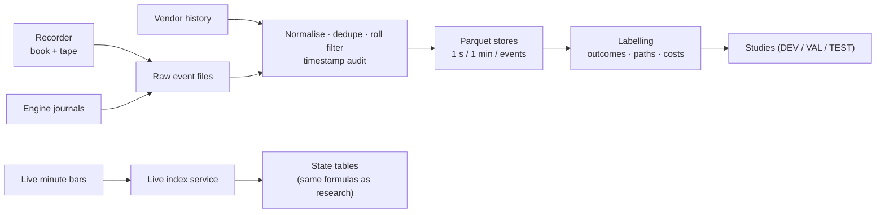

# Data platform

Research is only as good as the data under it. Most of the effort here went into collecting market data continuously, keeping it point-in-time and proving that the timestamps are right.

## Sources and volumes (November 2026)

| Source | What | Volume |
|---|---|---|
| Market recorder (own, C#) | Full order book (L2 / L3) and tape of the trading session, written through a named pipe into rolling files | ≈ 3.8 bn market events |
| Engine journals | Order-book "wall" events with flow at the trigger, signals, fills, price paths of every trade (sub-second), shadow trades, rejected candidates with the reason | 79 GB (72 GB order-book events) |
| Research event store | Normalised raw events for book reconstruction and labelling | 34 GB |
| CME options | Daily open interest and settlements for index-futures options (strike levels, gamma estimates) | 22 GB |
| Licensed history | Vendor tick aggregates; 1-minute OHLCV 2019–2026 for ES, NQ, RTY, YM with contract-roll handling | 3.2 GB + per-instrument parquet |
| Live minute bars | Exchange-time minute bars from the trading PC to the cloud (OHLC, volume, aggressor buy / sell volume, spread, measured lag), queued for up to 24 h if the network fails | every minute, ES / NQ / RTY |
| Public / macro | Fed and BLS calendars, Treasury yields, SEC EDGAR / XBRL fundamentals of the largest index members, Cboe volatility indices | daily |

## Rules
- **Point-in-time.** Every stored value carries the moment it became known. A forecast for day D is built only from data available before its publication time, and a backfill never overwrites what was known at the time.
- **Exchange time, not PC time.** Bars are built on the exchange timestamp of the trade, so a delayed feed does not shift bars. The measured lag is a separate column.
- **Versioned schemas.** Journal files carry a schema version in the file name. A new column means a new version, never a silent change of meaning.
- **Timestamp audits before analysis.** Before any study, every time column is checked against an independent source. This rule exists because of a real incident (see [ENGINEERING_LOG.md](ENGINEERING_LOG.md#1-the-12-hour-shift)).
- **Integrity checks.** Duplicate removal, contract-roll filters (one dominant contract per session), gap reports, and cross-checks of recorded bars against vendor bars (99.6–100 % exact close match after correction).

## Pipeline

The same formulas run in research and in production. A research model is frozen with its coefficients and validated on held-out years. It is then re-implemented in the live service and in the engine, and the live implementation is checked against the research output for parity (for example, 0.08 points mean difference on a 0–100 scale over 100 000 minutes).
