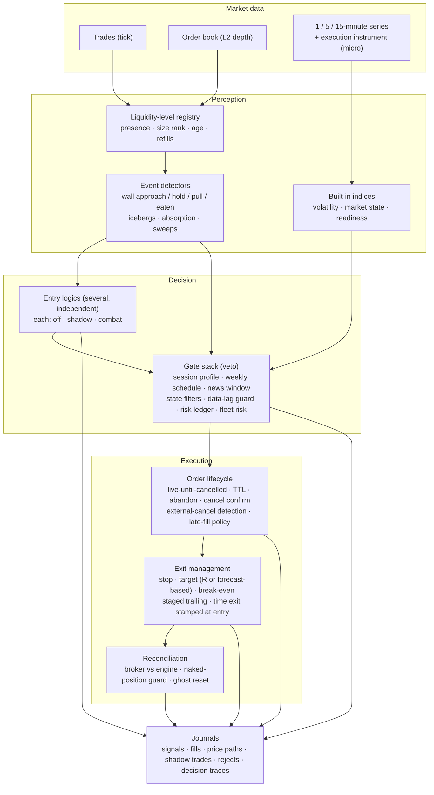

# Trading engine

A NinjaTrader 8 strategy written in C#. Production size: 117 source files, ≈ 49 000 lines, organised as ≈ 100 partial-class modules with one responsibility each. It is sold as **MicroFlow** and runs on client PCs under a licence. Logic names, parameters and thresholds are private; this document describes the architecture.

## Processing pipeline

## Design decisions

**Event-driven, not bar-driven.**
- Order-book events arrive tens of times per second. The registry keeps every price level with its size history, rank and lifecycle.
- Detectors emit typed events (approach, hold, pull, eaten, refill) into a bus.
- Bar-based work (indices, oscillators, daily statistics) runs only on closed bars, so the same code gives the same answer in replay and live.

**Shadow and combat for everything.**
- Every entry logic and every new filter can run in shadow mode: it builds the full signal, places a *virtual* order, manages it to the exit and journals the result next to the real decisions.
- Switching to combat is a configuration change pushed over the air, not a new build.
- This is how a filter that looked good in research is checked against live fills before it can block a single real trade.

**Gates have veto power.**
- **Order of checks:**
  - signal logic proposes;
  - gates may only remove;
  - the risk layer may always say no.
- **The gates are:**
  - session profiles (day session vs overnight, each with its own parameter set);
  - a weekly schedule;
  - news windows;
  - market-state filters;
  - a data-lag guard (no entries and no stop moves while the feed is stale);
  - a risk ledger that survives restarts;
  - portfolio risk across instruments.

**Execution is treated as a distributed system.**
- **Asynchronous cancel.** A cancel is not done until the broker confirms it. A fill can arrive after the cancel was sent (late fill), and the engine has an explicit policy for it.
- **Entry orders stay live until the engine cancels them.** NinjaTrader's default bar-close expiry silently killed limit orders on 1-minute charts. If anyone else cancels an order (platform, broker, manual click), the engine detects it at once and resets its state instead of waiting for a timeout.
- **Reconciliation.** Positions are reconciled against the broker account; a "naked" position (no protective stop) triggers escalation.
- **Exits:**
  - time exits are stamped on the trade at entry, so they survive a profile switch at the session boundary;
  - targets can be expressed in R or as a fraction of a server-side range forecast, with a fixed-R fallback when the forecast is not available.

**Built-in indices instead of external dependencies.** Market-state indices that a filter depends on are computed inside the engine from its own series:
- no extra indicator to install;
- no network round-trip in the signal path.

The server only supplies slow context, such as the daily range forecast, and every such input has a fallback.

**Observability.**
- One structured line per decision.
- Per-minute performance counters: processing time per series, CPU, garbage collection, data lag.
- Day summaries per logic.
- CSV journals with versioned schemas.
- Telemetry to the cloud for the owner's build. The commercial build keeps journals local.

## Related public code
- [`ninjascript/FeedLagMonitor.cs`](../ninjascript/FeedLagMonitor.cs) — the principle behind the data-lag guard.
- [`src/qs_gate`](../src/qs_gate) — the permission-window and time-exit bookkeeping used by state filters.
